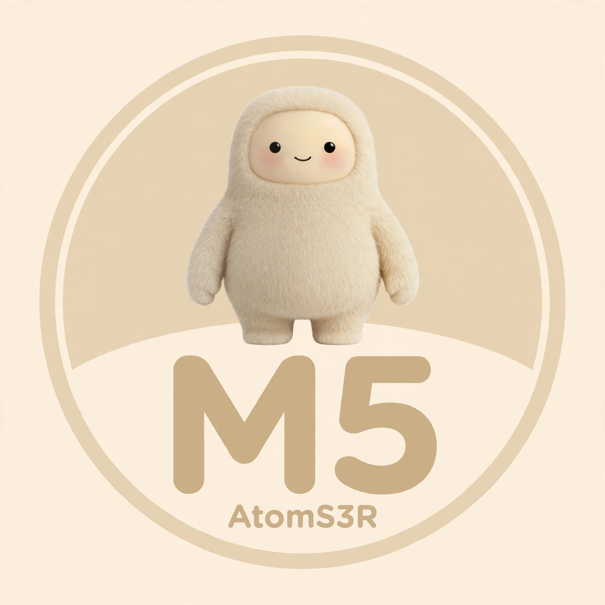
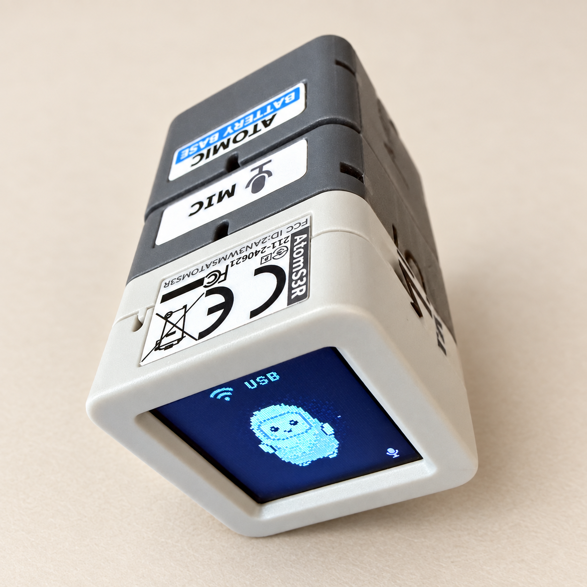
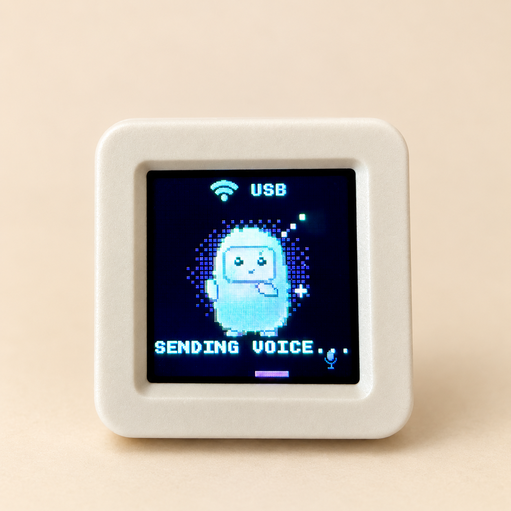

# ATOMS3R Muse Firmware

**English** | [简体中文](readme.CN.md)

<p align="center">
  
</p>

Community firmware for **M5Stack ATOMS3R + Atomic Echo Base**, with Muse chat,
MiniMax streaming text-to-speech, voice selection saved on the device, an optional
Shadowsocks 2022 TCP proxy, and 128×128 image display without a public upload.

This adaptation is based on the
[Meta Muse Gadget SDK](https://github.com/facebookincubator/muse-gadget-sdk).
The tested hardware is an ATOMS3R with 8 MB flash and 8 MB PSRAM, paired with
an Atomic Echo Base. The build helper targets this combination. Other boards
supported by the upstream SDK have not been validated in this project.

## Features

- Muse App pairing, Wi-Fi connectivity, push-to-talk input, and on-screen captions.
- MiniMax streaming text-to-speech: playback starts as audio arrives, with sentence-by-sentence processing that handles blank lines and multiple paragraphs.
- Voice selection through the USB serial console, saved across restarts without recompiling.
- Optional experimental live voice calls (off by default): tap the screen button to call or hang up; hold it for a voice note.
- Optional Shadowsocks 2022 routing for Muse connections, MiniMax speech, and HTTPS image downloads, with TLS certificate and hostname verification.
- Image requests from the ATOMS3R instruct Muse to export a 128×128 square image and send it as base64 through the encrypted device control connection. This avoids a public upload; successful delivery depends on Muse completing the export and device command.
- PNG and baseline JPEG display. Inline images must be exactly 128×128 pixels; WebP, GIF, and progressive JPEG are not supported.

## Device photos

<p align="center">
  
  
</p>

<p align="center"><em>Assembled device and voice-message screen.</em></p>

The Atomic Battery Base shown in the left photo is optional.

## Quick start

Install Python 3, Git, and **ESP-IDF v6.0.3**, then activate the ESP-IDF environment.
You also need a Muse App account, an ATOMS3R with Atomic Echo Base, and a
USB data cable. MiniMax speech requires a MiniMax API key.
The first build downloads dependencies through IDF Component Manager.

1. Clone this repository and copy `config/example.json` to `config/local.json` at the repository root.
2. Edit `config/local.json` and enter your own Muse SDK token.
3. To enable speech, set `minimax.enabled` to `true` and provide your API key. To enable the proxy, enter your node settings and set `proxy.enabled` to `true`.
4. Build and flash from a terminal with ESP-IDF activated.

Windows PowerShell:

```powershell
git clone https://github.com/rlog/atoms3r-muse-firmware.git
Set-Location atoms3r-muse-firmware
Copy-Item config/example.json config/local.json
# Edit config/local.json, then activate your ESP-IDF v6.0.3 environment:
. C:/path/to/esp-idf/export.ps1
python tools/build.py
python tools/build.py --action flash --port COM5
```

Linux/macOS:

```sh
git clone https://github.com/rlog/atoms3r-muse-firmware.git
cd atoms3r-muse-firmware
cp config/example.json config/local.json
# After editing your private configuration:
. /path/to/esp-idf/export.sh
python tools/build.py
python tools/build.py --action flash --port /dev/ttyACM0
```

Replace the ESP-IDF path and serial port in the examples with your own.

In the Muse App, open Settings → Devices, enable Developer mode, and add your
MuseGadget device. Configure Wi-Fi and press the ATOMS3R's physical screen button
when prompted to confirm pairing.
Get your SDK token from [Muse Gadgets](https://gadgets.muse.ai/).

## Configuration

Your actual settings belong in `config/local.json`, which Git ignores.
The repository provides `config/example.json` without credentials.

| Setting | Purpose |
|---|---|
| `muse.sdk_token` | Your Muse Gadget SDK token, required to use Muse. It may be left empty for a build-only check. |
| `muse.realtime_voice` | Enable experimental live calls; defaults to `false`. With it off, hold to record and release to send; MiniMax can speak replies. |
| `minimax.enabled` / `minimax.api_key` | Enable MiniMax text-to-speech and supply your API key; disabled by default. |
| `minimax.url` | The HTTPS speech endpoint. The example uses the China endpoint; international accounts should use their service endpoint. |
| `minimax.model` / `minimax.voice` | Speech model and default voice ID. A voice already saved on the device takes precedence. |
| `proxy.enabled` | Enable proxy routing; disabled by default. |
| `proxy.method` | Must be `2022-blake3-aes-128-gcm`. |
| `proxy.server` / `proxy.port` / `proxy.key` | Proxy server IPv4 address, server TCP port, and a base64-encoded 16-byte pre-shared key (PSK). |

The proxy supports the SS2022 method listed above and destination TCP port 443
only. It does not support VLESS/REALITY, subscription URLs, or UDP, and does not
route all device traffic. Use a compatible proxy server that permits the required
connections. The device also needs SNTP time synchronization for the proxy to work.

`tools/build.py` validates the JSON and generates the ignored
`esp32/config/sdkconfig.local`. It also updates the relevant settings in an
existing build directory, preventing an old ESP-IDF sdkconfig from overriding
new values. After changing credentials, node settings, or compiled defaults,
rebuild and flash without editing C/C++.
These are build-time settings: personal firmware binaries contain the configured
credentials and should not be published. Normal flashing preserves pairing,
Wi-Fi, and voice settings in nonvolatile storage (NVS); a full flash erase removes them.

The first build generates a private `esp32/dev_signing_key.pem` for OTA application
signing. Git ignores this file. Keep it so later OTA updates can use the same
signing key. Firmware signed with a new key can be installed over USB; an existing
firmware will not accept OTA images signed with a different key.
Application signature verification remains enabled. This project does not enable
hardware Secure Boot or burn eFuses.

Live calls use Muse's own voice service, and require a VM that accepts calls from the device.
On ATOMS3R, the microphone is muted while Muse speaks. MiniMax voice settings
apply to voice-note replies, not live calls. If the screen is asleep, the first
short press only wakes it; press again to call.

The tested VM returned HTTP 404 for live-call admission, and live calls were
unavailable in the phone app on the same account. Enabling firmware support
does not enable the server feature; see [validation](docs/VALIDATION.md) and
[upstream issue #310](https://github.com/facebookincubator/muse-gadget-sdk/issues/310).

Change the voice at runtime:

```text
>tts.voice=Chinese (Mandarin)_Cute_Spirit
>tts.voice
>tts.test
```

With MiniMax enabled, send these commands through a serial terminal at 115200
baud. Keep the leading `>` character. The new voice is used for subsequent speech
segments; an in-progress synthesis request keeps its original voice. Voice IDs
are validated by MiniMax when speech is requested. The Muse App has no custom
voice-selection menu for this firmware. The `>tts.test` command needs a working
Wi-Fi connection to MiniMax.

For implementation details, see [speech](esp32/components/muse/MINIMAX.md),
[proxy routing](esp32/components/muse/PROXY.md),
[images](esp32/components/muse/IMAGES.md), and the
[upstream ESP32 documentation](esp32/README.md).
Muse App may still request device-tool permissions under its own policy;
the base64 route removes the public-upload step.

## Validation and contributing

The full host test suite runs in a POSIX environment with a C/C++ compiler,
CMake, pkg-config, and the mbedTLS, libpng, and cJSON development packages
(`libmbedtls-dev`, `libpng-dev`, and `libcjson-dev` on Debian/Ubuntu).
Install the Python dependencies with `pip install -r requirements-dev.txt`
before running the tests below.

```sh
python -m unittest discover -s tests
python tools/check_secrets.py
# Build once to download cJSON and other dependencies, then run firmware host tests:
python -m unittest discover -s esp32/tests
```

The pairing cryptography test needs `IDF_PATH`; some tests are skipped when
their dependencies are unavailable.
CI builds all added features with the public `config/ci.json` fixture and runs
host tests and credential checks. Its address is in a documentation-only range
and its key is a public test key. Use your own server and key for an actual connection.

See [hardware validation](docs/VALIDATION.md),
[contribution guidelines](CONTRIBUTING.md), and
[security reporting](SECURITY.md). Some supporting documents are currently in Chinese.

## License

[Apache-2.0](LICENSE). See [NOTICE](NOTICE) for upstream attribution and community
changes, and [THIRD_PARTY_NOTICES.md](THIRD_PARTY_NOTICES.md) for dependency and
font licenses.
This is an independent community project and is not officially maintained by
Muse, Meta, MiniMax, or M5Stack.

### SDK third-party licenses

| Path | Upstream | License |
|---|---|---|
| [`esp32/components/minimp3/include/minimp3.h`](esp32/components/minimp3) | [lieff/minimp3](https://github.com/lieff/minimp3) | CC0-1.0, see [`LICENSE`](esp32/components/minimp3/LICENSE) |
| [`esp32/components/muse/boards/ostb_echoear_display_init.h`](esp32/components/muse/boards/ostb_echoear_display_init.h) | [78/xiaozhi-esp32 ESP-VoCat panel sequence](https://github.com/78/xiaozhi-esp32/blob/0d576d3d4c049c6f55eaf879725dc23e516511b4/main/boards/espressif/esp-vocat/esp_vocat.cc) | MIT, retained in the file header |
| ST7789 tuning table in [`board_atk_dnesp32s3_box2.c`](esp32/components/muse/boards/board_atk_dnesp32s3_box2.c) | [78/xiaozhi-esp32 ATK-DNESP32S3-BOX2 board](https://github.com/78/xiaozhi-esp32/blob/a78ca19d5bc9a12ee0853b9f509530276d36aa03/main/boards/alientek/atk-dnesp32s3-box2-wifi/atk_dnesp32s3_box2.cc) | MIT, see [`xiaozhi-esp32.txt`](esp32/devices/licenses/xiaozhi-esp32.txt) |
| JD9853A initialization sequence in [`board_seeed_xiao_s3_147.c`](esp32/components/muse/boards/board_seeed_xiao_s3_147.c) | [Seeed-Studio/Seeed_GFX2](https://github.com/Seeed-Studio/Seeed_GFX2) | MIT, see [`Seeed_GFX2.txt`](esp32/devices/licenses/Seeed_GFX2.txt) |
| GC9107 initialization sequence in [`board_m5stack_atoms3.c`](esp32/components/muse/boards/board_m5stack_atoms3.c) | [M5Stack M5GFX `Panel_GC9107`](https://github.com/m5stack/M5GFX/blob/df770af3a58327cd1d4736db610a3ed8906c0952/src/lgfx/v1/panel/Panel_GC9A01.hpp), from LovyanGFX | FreeBSD, see [`LovyanGFX.txt`](esp32/devices/licenses/LovyanGFX.txt) |
| [`esp32/components/esp_lcd_gc9107`](esp32/components/esp_lcd_gc9107) | Espressif's `espressif/esp_lcd_gc9107` 2.0.0 from the ESP Component Registry, changed to build on ESP-IDF 6 | Apache-2.0, Espressif's copyright, see [`license.txt`](esp32/components/esp_lcd_gc9107/license.txt) |
| [`esp32/components/muse/boards/viewe_smartring_display_init.h`](esp32/components/muse/boards/viewe_smartring_display_init.h) | [VIEWESMART/smartring_plus](https://github.com/VIEWESMART/smartring_plus) panel sequence | Apache-2.0 under VIEWE's copyright, in the file header |
| [`esp32/components/muse/boards/waveshare_s3_185b_init.h`](esp32/components/muse/boards/waveshare_s3_185b_init.h) | [waveshareteam/ESP32-S3-Touch-LCD-1.85B](https://github.com/waveshareteam/ESP32-S3-Touch-LCD-1.85B/tree/7232af4c501c64d34215b73e1d8319376dfd9c19/examples/esp-idf/05_bq27220/components/esp32_s3_touch_lcd_1_85B) panel sequences | Apache-2.0, in the file header |
| ExecuTorch runtime with its ESP-NN delegate, for the opt-in wake word (registry component, not vendored; see [`docs/executorch.md`](esp32/docs/executorch.md)) | [pytorch/executorch](https://github.com/pytorch/executorch), with [espressif/esp-nn](https://github.com/espressif/esp-nn) | BSD-3-Clause AND Apache-2.0 AND Apache-2.0 WITH LLVM-exception AND NCSA AND MIT, see the component's `LICENSE`; bundled third-party notices in the component. esp-nn: Apache-2.0 |
| TensorFlow Lite Micro's microfrontend, for the opt-in wake word (registry component, not vendored) | [esphome/esp-micro-speech-features](https://github.com/esphome-libs/esp-micro-speech-features) | Apache-2.0 (TensorFlow Authors, Kevin Ahrendt); its kissfft files BSD-3-Clause (Mark Borgerding) |
| [`esp32/components/muse_wakeword/models/hey_muse.pte`](esp32/components/muse_wakeword/models) | Trained for this SDK on public-domain, CC0 and CC BY data | Training data credits, as CC BY requires, in [`ATTRIBUTION.md`](esp32/components/muse_wakeword/models/ATTRIBUTION.md) |
| [`esp32/main/pixel_font.c`](esp32/main/pixel_font.c) | Adafruit GFX `glcdfont.c` | BSD-2-Clause, in the file header |
| [`esp32/components/muse/fonts/`](esp32/components/muse/fonts) | GNU Unifont 16.0.04, Noto Sans SC, and Montserrat Medium via LVGL, subsets (see its README) | SIL Open Font License 1.1 (Unifont also GPL-2.0+ with the font embedding exception) |
| [`esp32/main/fonts/epaper_154g_caption_font.h`](esp32/main/fonts/epaper_154g_caption_font.h) | GNU Unifont 16.0.04, subset (see [`README.md`](esp32/main/fonts/README.md)) | SIL Open Font License 1.1, or GPL-2.0+ with the font embedding exception |
| [`esp32/components/muse/eink/fonts/montserrat.ttf`](esp32/components/muse/eink/fonts) | Montserrat Medium, via LVGL v9.5.0 | SIL Open Font License 1.1 |
| [`esp32/components/muse/eink/fonts/unscii.ttf`](esp32/components/muse/eink/fonts) | unscii-8 | Public domain |
| [`esp32/components/muse/eink/fonts/symbols.ttf`](esp32/components/muse/eink/fonts) | Font Awesome 5 Free, via LVGL v9.5.0 | SIL Open Font License 1.1 (icons CC BY 4.0) |
| [`esp32/main/epd_ssd1677.c`](esp32/main/epd_ssd1677.c) | Seeed-reTerminal-E10xx-Firmware's SSD1677 refresh sequence | MIT, retained in the file header |
| [`esp32/components/tinyh264/src`](esp32/components/tinyh264) | the Android Open Source Project's H.264 decoder, via [udevbe/tinyh264](https://github.com/udevbe/tinyh264) | Apache-2.0, AOSP's copyright, see [`LICENSE`](esp32/components/tinyh264/LICENSE) |
| [`esp32/components/libvpx_vp8/src`](esp32/components/libvpx_vp8) | [libvpx](https://chromium.googlesource.com/webm/libvpx) v1.16.0's VP8 decoder, trimmed | BSD-3-Clause, the WebM Project authors' copyright, see [`LICENSE`](esp32/components/libvpx_vp8/LICENSE), with Google's patent grant in [`PATENTS`](esp32/components/libvpx_vp8/PATENTS) |

Dependencies fetched at build time are under their own licenses: ESP-IDF
components (into `esp32/managed_components/`), and the simulator's LVGL and
SDL (listed in [`esp32/simulator/THIRD_PARTY.md`](esp32/simulator/THIRD_PARTY.md)).

The Apache License does not cover the [Jollybot avatar](esp32/avatar).

Muse Gadgets Test's sample clips aren't in this repository: the app fetches a few
seconds of the Blender Foundation's open movies (CC BY 3.0) when one is
played, and shows their credits.

Muse Gadgets Test can use x264 (GPL-2.0) on the phone; this repository carries none
of its code. An APK or iPhone app you build with it is under the GPL
([`android/musegadgetstest/README.md`](android/musegadgetstest/README.md),
[`ios/musegadgetstest/README.md`](ios/musegadgetstest/README.md)).
