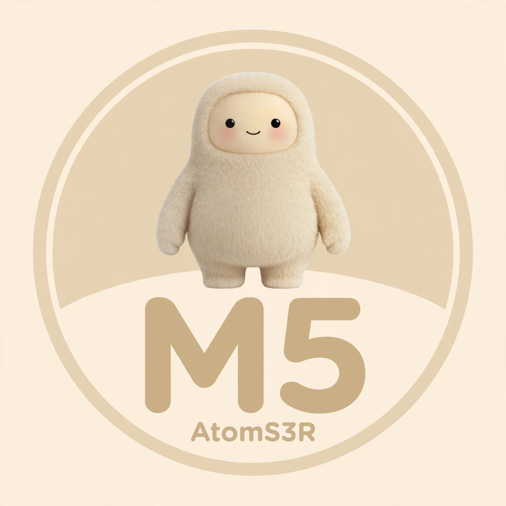
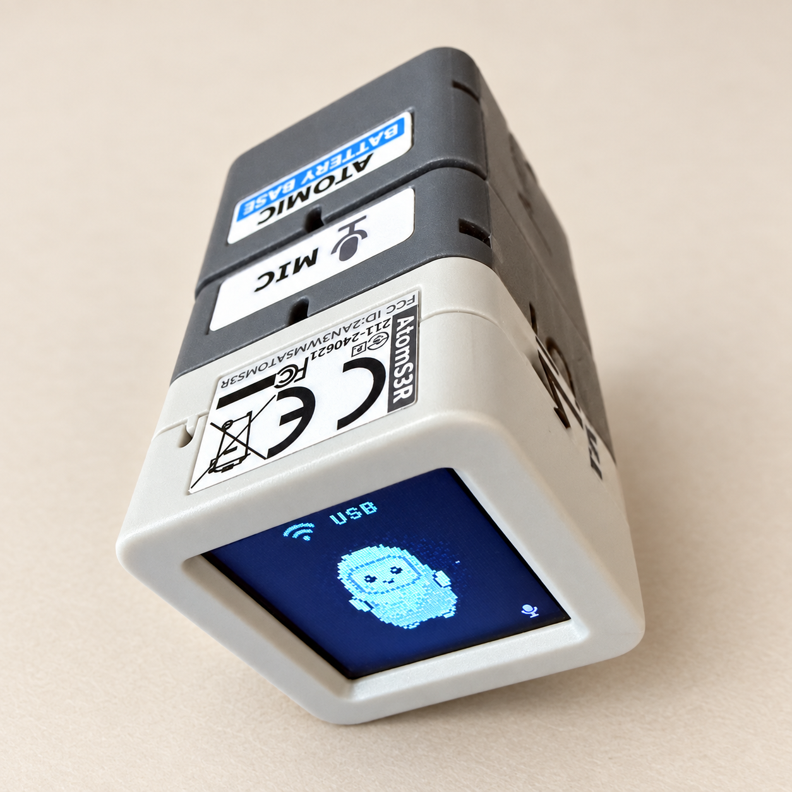
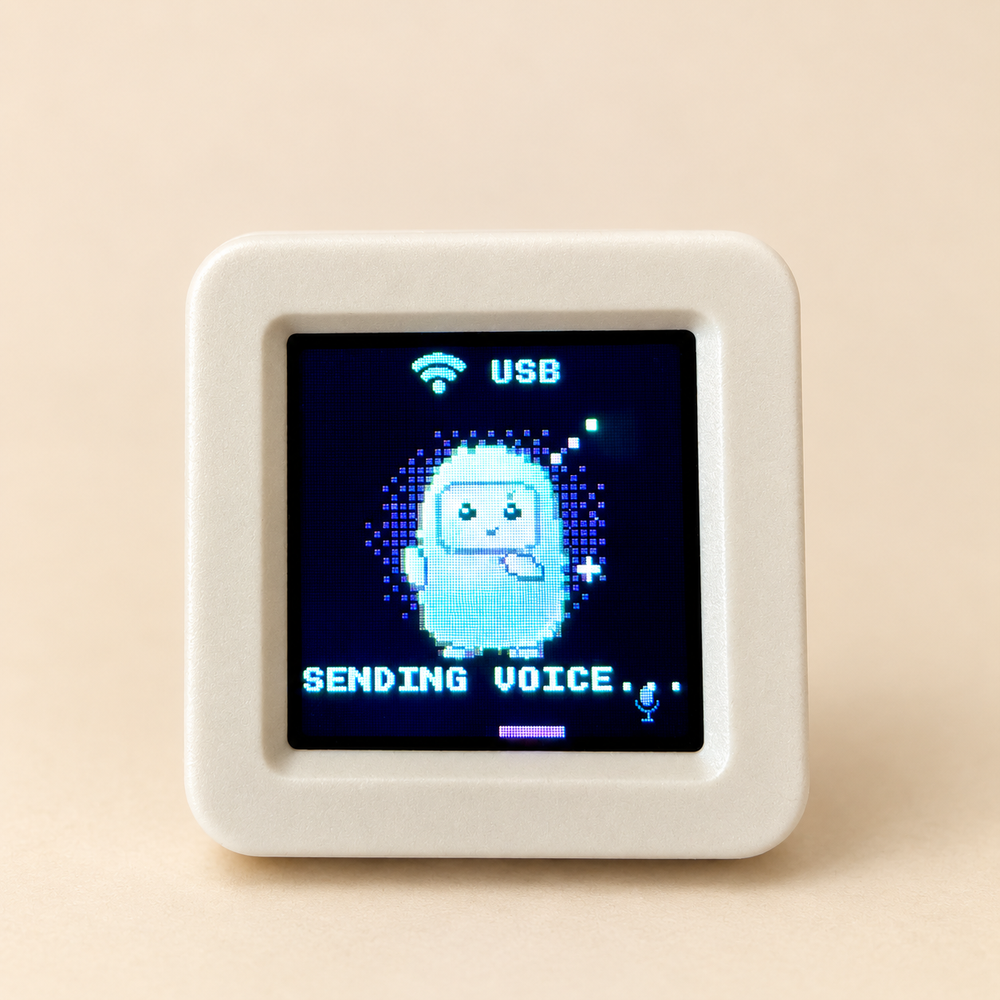

# ATOMS3R Muse Firmware

[English](README.md) | **简体中文**

<p align="center">
  
</p>

面向 **M5Stack ATOMS3R + Atomic Echo Base** 的社区固件，支持 Muse 聊天、MiniMax 流式语音合成、设备音色保存、可选 Shadowsocks 2022 TCP 代理，以及无需公网上传的 128×128 图片显示。

基于 [Meta Muse Gadget SDK](https://github.com/facebookincubator/muse-gadget-sdk)
的社区适配。已测试的硬件为 8 MB Flash / 8 MB PSRAM 版本的 ATOMS3R，
搭配 Atomic Echo Base。构建脚本针对这一组合；上游 SDK 支持的其他板型尚未在本项目验证。

## 功能

- 可选实验性实时语音通话（默认关闭）；默认按住说话、松开发送，由 MiniMax 播报回复。

- Muse App 配对、Wi-Fi 联网、按住按键录音与屏幕字幕。
- MiniMax 流式语音合成：音频到达后即可开始播放，文本分句处理，支持空行和多段落。
- 通过 USB 串口设置音色，重启后保留，无需重新编译。
- 可选 Shadowsocks 2022 代理，用于 Muse 连接、MiniMax 语音和 HTTPS 图片下载，保留 TLS 域名和证书验证。
- ATOMS3R 的生图请求会要求 Muse 导出 128×128 方图，并通过加密设备控制连接发送 base64 文件内容，无需公网上传。能否成功显示取决于 Muse 完成文件导出及设备调用。
- 支持 PNG 和基线 JPEG 显示。内联图片必须为 128×128 像素；不支持 WebP、GIF 和渐进式 JPEG。

## 实机展示

<p align="center">
  
  
</p>

<p align="center"><em>设备组装效果与语音发送界面。</em></p>

左图中的 Atomic Battery Base 为可选配件。

## 快速开始

需要 Python 3、Git 和 **ESP-IDF v6.0.3**，先按 Espressif 的安装说明安装并激活工具链。
还需要 Muse App 账号、ATOMS3R 与 Atomic Echo Base，以及一根 USB 数据线。
启用 MiniMax 语音合成需要 MiniMax API key。
首次构建会由 IDF Component Manager 下载依赖。

1. 克隆仓库，在仓库根目录将 `config/example.json` 复制为 `config/local.json`。
2. 编辑 `config/local.json`，填入自己的 Muse SDK token。
3. 需要语音时，将 `minimax.enabled` 设为 `true` 并填入 API key；需要代理时填写节点参数并启用。
4. 在激活 ESP-IDF 的终端中执行构建和刷写。

Windows PowerShell：

```powershell
git clone https://github.com/rlog/atoms3r-muse-firmware.git
Set-Location atoms3r-muse-firmware
Copy-Item config/example.json config/local.json
# 编辑 config/local.json，然后激活你的 ESP-IDF v6.0.3：
. C:/path/to/esp-idf/export.ps1
python tools/build.py
python tools/build.py --action flash --port COM5
```

Linux/macOS：

```sh
git clone https://github.com/rlog/atoms3r-muse-firmware.git
cd atoms3r-muse-firmware
cp config/example.json config/local.json
# 编辑私有配置后：
. /path/to/esp-idf/export.sh
python tools/build.py
python tools/build.py --action flash --port /dev/ttyACM0
```

请将示例中的 ESP-IDF 路径与串口号替换为自己的实际值。

通过 Muse App → 设置 → 设备 → 开启开发者模式 → 添加 MuseGadget 设备，
配置 Wi-Fi，并在配对提示时按下 ATOMS3R 屏幕实体按钮。
SDK token 从 [Muse Gadgets](https://gadgets.muse.ai/) 获取。

## 配置

实际配置是 `config/local.json`；仓库仅提供不含凭据的 `config/example.json`。

| 配置项 | 含义 |
|---|---|
| `muse.sdk_token` | 使用 Muse 所需的 Gadget SDK token；仅检查构建时可以留空 |
| `muse.realtime_voice` | 启用实验性实时通话，默认 `false`；关闭时按住说话、松开发送，由 MiniMax 播报回复 |
| `minimax.enabled` / `minimax.api_key` | 启用 MiniMax 语音合成并提供 API key，默认关闭 |
| `minimax.url` | HTTPS 语音接口；示例为中国区，国际账户按服务接口修改 |
| `minimax.model` / `minimax.voice` | 语音模型与默认音色 ID；设备已保存的音色优先 |
| `proxy.enabled` | 是否启用代理，默认关闭 |
| `proxy.method` | 固定为 `2022-blake3-aes-128-gcm` |
| `proxy.server` / `proxy.port` / `proxy.key` | 代理服务器 IPv4 地址、服务器 TCP 端口、base64 编码的 16 字节预共享密钥（PSK） |

代理仅支持上述 SS2022 加密方法与目标 TCP 端口 443，不支持 VLESS/REALITY、
订阅链接或 UDP，也不会代理设备的全部网络流量。请使用兼容的代理服务器，
并允许所需的目标连接。设备还需要通过 SNTP 校时，代理才能正常工作。

`tools/build.py` 会校验 JSON 并生成被 Git 忽略的 `esp32/config/sdkconfig.local`。
它也会更新已有构建目录的对应配置，避免 ESP-IDF 的旧 sdkconfig 覆盖新设置。
修改 token、API key、节点和默认参数后重新构建、刷写即可，无需编辑 C/C++。
这些参数属于编译配置，固件二进制会包含它们；不要公开个人构建产物。
普通刷写会保留非易失存储（NVS）中的配对、Wi-Fi 和音色设置；整片擦除会清除这些设置。

首次构建会自动生成私有 `esp32/dev_signing_key.pem`，用于 OTA 应用签名，
该文件被 Git 忽略。保留它以便后续签名 OTA 更新使用同一个密钥；
重新生成密钥后的固件可通过 USB 刷入，旧固件不会接受其他密钥签名的 OTA。
本项目保留应用签名校验，不启用硬件 Secure Boot 或烧写 eFuse。

实时通话使用 Muse 自带的语音服务，需服务端允许该设备发起通话；ATOMS3R 在 Muse 播放时会关闭麦克风。
MiniMax 音色设置只影响长按语音消息的回复播报。屏幕休眠时，第一次短按只唤醒，再按一次才开始通话。

本轮实机测试中，实时通话接口返回 HTTP 404，同一账号手机端也没有可用的通话入口。
固件开关不能开通服务端功能，详见[验证记录](docs/VALIDATION.md)和[上游问题 #310](https://github.com/facebookincubator/muse-gadget-sdk/issues/310)。

音色在设备运行时修改：

```text
>tts.voice=Chinese (Mandarin)_Cute_Spirit
>tts.voice
>tts.test
```

启用 MiniMax 后，在串口终端以 115200 波特率发送以上命令，保留开头的 `>`。
新音色用于后续语音片段；正在合成的请求继续使用原音色。
音色 ID 是否可用由 MiniMax 在合成时验证。Muse App 中没有适用于本固件的专用音色菜单。
`>tts.test` 需要设备通过 Wi-Fi 正常连接 MiniMax。

更多实现细节：
[语音](esp32/components/muse/MINIMAX.md)、
[代理](esp32/components/muse/PROXY.md)、
[图片](esp32/components/muse/IMAGES.md)、
[上游 ESP32 文档](esp32/README.md)。
Muse App 仍可根据自身策略要求设备工具权限；base64 流程取消的是公网上传步骤。

## 验证与贡献

完整主机测试需要 POSIX 环境、C/C++ 编译器、CMake、pkg-config，以及 mbedTLS、
libpng 和 cJSON 开发包（Debian/Ubuntu 中为 `libmbedtls-dev`、`libpng-dev` 和 `libcjson-dev`）。
运行以下测试前，使用 `pip install -r requirements-dev.txt` 安装 Python 依赖。

```sh
python -m unittest discover -s tests
python tools/check_secrets.py
# 先构建一次以下载 cJSON 等依赖，再运行固件主机测试：
python -m unittest discover -s esp32/tests
```

配对密码学测试需要 `IDF_PATH`；未满足依赖时部分测试会跳过。
CI 使用公开测试配置 `config/ci.json` 构建全部新增功能，并运行主机测试及密钥检查；
其中地址属于文档保留网段，密钥仅供公开测试；实际连接请使用自己的服务器与密钥。

硬件验证记录见 [docs/VALIDATION.md](docs/VALIDATION.md)。
贡献流程见 [CONTRIBUTING.md](CONTRIBUTING.md)，漏洞报告见 [SECURITY.md](SECURITY.md)。

## 许可证

[Apache-2.0](LICENSE)。上游归属和改动说明见 [NOTICE](NOTICE)，
第三方组件与字体的许可证见 [THIRD_PARTY_NOTICES.md](THIRD_PARTY_NOTICES.md)。
本项目由社区独立维护，并非 Muse、Meta、MiniMax 或 M5Stack 官方项目。

### SDK third-party licenses

| Path | Upstream | License |
|---|---|---|
| [`esp32/components/minimp3/include/minimp3.h`](esp32/components/minimp3) | [lieff/minimp3](https://github.com/lieff/minimp3) | CC0-1.0, see [`LICENSE`](esp32/components/minimp3/LICENSE) |
| [`esp32/components/muse/boards/ostb_echoear_display_init.h`](esp32/components/muse/boards/ostb_echoear_display_init.h) | [78/xiaozhi-esp32 ESP-VoCat panel sequence](https://github.com/78/xiaozhi-esp32/blob/0d576d3d4c049c6f55eaf879725dc23e516511b4/main/boards/espressif/esp-vocat/esp_vocat.cc) | MIT, retained in the file header |
| ST7789 tuning table in [`board_atk_dnesp32s3_box2.c`](esp32/components/muse/boards/board_atk_dnesp32s3_box2.c) | [78/xiaozhi-esp32 ATK-DNESP32S3-BOX2 board](https://github.com/78/xiaozhi-esp32/blob/a78ca19d5bc9a12ee0853b9f509530276d36aa03/main/boards/alientek/atk-dnesp32s3-box2-wifi/atk_dnesp32s3_box2.cc) | MIT, see [`xiaozhi-esp32.txt`](esp32/devices/licenses/xiaozhi-esp32.txt) |
| JD9853A initialization sequence in [`board_seeed_xiao_s3_147.c`](esp32/components/muse/boards/board_seeed_xiao_s3_147.c) | [Seeed-Studio/Seeed_GFX2](https://github.com/Seeed-Studio/Seeed_GFX2) | MIT, see [`Seeed_GFX2.txt`](esp32/devices/licenses/Seeed_GFX2.txt) |
| GC9107 initialization sequence in [`board_m5stack_atoms3.c`](esp32/components/muse/boards/board_m5stack_atoms3.c) | [M5Stack M5GFX `Panel_GC9107`](https://github.com/m5stack/M5GFX/blob/df770af3a58327cd1d4736db610a3ed8906c0952/src/lgfx/v1/panel/Panel_GC9A01.hpp), from LovyanGFX | FreeBSD, see [`LovyanGFX.txt`](esp32/devices/licenses/LovyanGFX.txt) |
| [`esp32/components/esp_lcd_gc9107`](esp32/components/esp_lcd_gc9107) | Espressif's `espressif/esp_lcd_gc9107` 2.0.0 from the ESP Component Registry, changed to build on ESP-IDF 6 | Apache-2.0, Espressif's copyright, see [`license.txt`](esp32/components/esp_lcd_gc9107/license.txt) |
| [`esp32/components/muse/boards/viewe_smartring_display_init.h`](esp32/components/muse/boards/viewe_smartring_display_init.h) | [VIEWESMART/smartring_plus](https://github.com/VIEWESMART/smartring_plus) panel sequence | Apache-2.0 under VIEWE's copyright, in the file header |
| [`esp32/components/muse/boards/waveshare_s3_185b_init.h`](esp32/components/muse/boards/waveshare_s3_185b_init.h) | [waveshareteam/ESP32-S3-Touch-LCD-1.85B](https://github.com/waveshareteam/ESP32-S3-Touch-LCD-1.85B/tree/7232af4c501c64d34215b73e1d8319376dfd9c19/examples/esp-idf/05_bq27220/components/esp32_s3_touch_lcd_1_85B) panel sequences | Apache-2.0, in the file header |
| ExecuTorch runtime with its ESP-NN delegate, for the opt-in wake word (registry component, not vendored; see [`docs/executorch.md`](esp32/docs/executorch.md)) | [pytorch/executorch](https://github.com/pytorch/executorch), with [espressif/esp-nn](https://github.com/espressif/esp-nn) | BSD-3-Clause AND Apache-2.0 AND Apache-2.0 WITH LLVM-exception AND NCSA AND MIT, see the component's `LICENSE`; bundled third-party notices in the component. esp-nn: Apache-2.0 |
| TensorFlow Lite Micro's microfrontend, for the opt-in wake word (registry component, not vendored) | [esphome/esp-micro-speech-features](https://github.com/esphome-libs/esp-micro-speech-features) | Apache-2.0 (TensorFlow Authors, Kevin Ahrendt); its kissfft files BSD-3-Clause (Mark Borgerding) |
| [`esp32/components/muse_wakeword/models/hey_muse.pte`](esp32/components/muse_wakeword/models) | Trained for this SDK on public-domain, CC0 and CC BY data | Training data credits, as CC BY requires, in [`ATTRIBUTION.md`](esp32/components/muse_wakeword/models/ATTRIBUTION.md) |
| [`esp32/main/pixel_font.c`](esp32/main/pixel_font.c) | Adafruit GFX `glcdfont.c` | BSD-2-Clause, in the file header |
| [`esp32/components/muse/fonts/`](esp32/components/muse/fonts) | GNU Unifont 16.0.04, Noto Sans SC, and Montserrat Medium via LVGL, subsets (see its README) | SIL Open Font License 1.1 (Unifont also GPL-2.0+ with the font embedding exception) |
| [`esp32/main/fonts/epaper_154g_caption_font.h`](esp32/main/fonts/epaper_154g_caption_font.h) | GNU Unifont 16.0.04, subset (see [`README.md`](esp32/main/fonts/README.md)) | SIL Open Font License 1.1, or GPL-2.0+ with the font embedding exception |
| [`esp32/components/muse/eink/fonts/montserrat.ttf`](esp32/components/muse/eink/fonts) | Montserrat Medium, via LVGL v9.5.0 | SIL Open Font License 1.1 |
| [`esp32/components/muse/eink/fonts/unscii.ttf`](esp32/components/muse/eink/fonts) | unscii-8 | Public domain |
| [`esp32/components/muse/eink/fonts/symbols.ttf`](esp32/components/muse/eink/fonts) | Font Awesome 5 Free, via LVGL v9.5.0 | SIL Open Font License 1.1 (icons CC BY 4.0) |
| [`esp32/main/epd_ssd1677.c`](esp32/main/epd_ssd1677.c) | Seeed-reTerminal-E10xx-Firmware's SSD1677 refresh sequence | MIT, retained in the file header |
| [`esp32/components/tinyh264/src`](esp32/components/tinyh264) | the Android Open Source Project's H.264 decoder, via [udevbe/tinyh264](https://github.com/udevbe/tinyh264) | Apache-2.0, AOSP's copyright, see [`LICENSE`](esp32/components/tinyh264/LICENSE) |
| [`esp32/components/libvpx_vp8/src`](esp32/components/libvpx_vp8) | [libvpx](https://chromium.googlesource.com/webm/libvpx) v1.16.0's VP8 decoder, trimmed | BSD-3-Clause, the WebM Project authors' copyright, see [`LICENSE`](esp32/components/libvpx_vp8/LICENSE), with Google's patent grant in [`PATENTS`](esp32/components/libvpx_vp8/PATENTS) |

Dependencies fetched at build time are under their own licenses: ESP-IDF
components (into `esp32/managed_components/`), and the simulator's LVGL and
SDL (listed in [`esp32/simulator/THIRD_PARTY.md`](esp32/simulator/THIRD_PARTY.md)).

The Apache License does not cover the [Jollybot avatar](esp32/avatar).

Muse Gadgets Test's sample clips aren't in this repository: the app fetches a few
seconds of the Blender Foundation's open movies (CC BY 3.0) when one is
played, and shows their credits.

Muse Gadgets Test can use x264 (GPL-2.0) on the phone; this repository carries none
of its code. An APK or iPhone app you build with it is under the GPL
([`android/musegadgetstest/README.md`](android/musegadgetstest/README.md),
[`ios/musegadgetstest/README.md`](ios/musegadgetstest/README.md)).
